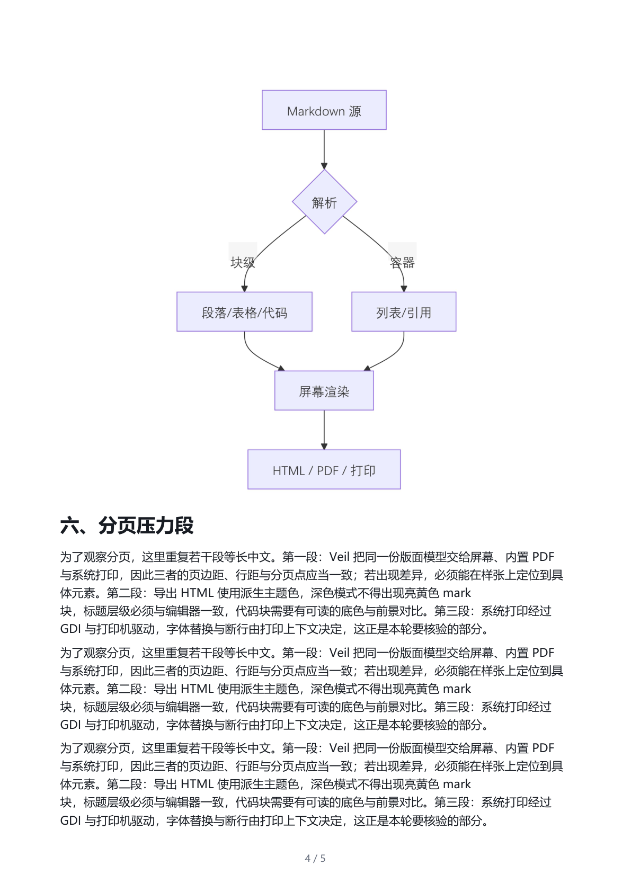

# Veil 实体打印样张（A4）

> 用途：核对短代码块不跨页、长表格每页有表头、断页落在行边界、页码连续。

## 1. 短代码块（应完整落在同一页）

```rust
fn print_probe() -> u32 {
    42
}
```

## 2. 图片（应完整、不裁切）



## 3. 超过一页的长表格（跨页时每页须重复表头）

| 行号 | 名称 | 说明 | 数值 |
| --- | --- | --- | --- |
| 1 | 第 1 行 | 用于验证跨页断行与表头重复的中文长文本条目 1 | 17 |
| 2 | 第 2 行 | 用于验证跨页断行与表头重复的中文长文本条目 2 | 34 |
| 3 | 第 3 行 | 用于验证跨页断行与表头重复的中文长文本条目 3 | 51 |
| 4 | 第 4 行 | 用于验证跨页断行与表头重复的中文长文本条目 4 | 68 |
| 5 | 第 5 行 | 用于验证跨页断行与表头重复的中文长文本条目 5 | 85 |
| 6 | 第 6 行 | 用于验证跨页断行与表头重复的中文长文本条目 6 | 102 |
| 7 | 第 7 行 | 用于验证跨页断行与表头重复的中文长文本条目 7 | 119 |
| 8 | 第 8 行 | 用于验证跨页断行与表头重复的中文长文本条目 8 | 136 |
| 9 | 第 9 行 | 用于验证跨页断行与表头重复的中文长文本条目 9 | 153 |
| 10 | 第 10 行 | 用于验证跨页断行与表头重复的中文长文本条目 10 | 170 |
| 11 | 第 11 行 | 用于验证跨页断行与表头重复的中文长文本条目 11 | 187 |
| 12 | 第 12 行 | 用于验证跨页断行与表头重复的中文长文本条目 12 | 204 |
| 13 | 第 13 行 | 用于验证跨页断行与表头重复的中文长文本条目 13 | 221 |
| 14 | 第 14 行 | 用于验证跨页断行与表头重复的中文长文本条目 14 | 238 |
| 15 | 第 15 行 | 用于验证跨页断行与表头重复的中文长文本条目 15 | 255 |
| 16 | 第 16 行 | 用于验证跨页断行与表头重复的中文长文本条目 16 | 272 |
| 17 | 第 17 行 | 用于验证跨页断行与表头重复的中文长文本条目 17 | 289 |
| 18 | 第 18 行 | 用于验证跨页断行与表头重复的中文长文本条目 18 | 306 |
| 19 | 第 19 行 | 用于验证跨页断行与表头重复的中文长文本条目 19 | 323 |
| 20 | 第 20 行 | 用于验证跨页断行与表头重复的中文长文本条目 20 | 340 |
| 21 | 第 21 行 | 用于验证跨页断行与表头重复的中文长文本条目 21 | 357 |
| 22 | 第 22 行 | 用于验证跨页断行与表头重复的中文长文本条目 22 | 374 |
| 23 | 第 23 行 | 用于验证跨页断行与表头重复的中文长文本条目 23 | 391 |
| 24 | 第 24 行 | 用于验证跨页断行与表头重复的中文长文本条目 24 | 408 |
| 25 | 第 25 行 | 用于验证跨页断行与表头重复的中文长文本条目 25 | 425 |
| 26 | 第 26 行 | 用于验证跨页断行与表头重复的中文长文本条目 26 | 442 |
| 27 | 第 27 行 | 用于验证跨页断行与表头重复的中文长文本条目 27 | 459 |
| 28 | 第 28 行 | 用于验证跨页断行与表头重复的中文长文本条目 28 | 476 |
| 29 | 第 29 行 | 用于验证跨页断行与表头重复的中文长文本条目 29 | 493 |
| 30 | 第 30 行 | 用于验证跨页断行与表头重复的中文长文本条目 30 | 510 |
| 31 | 第 31 行 | 用于验证跨页断行与表头重复的中文长文本条目 31 | 527 |
| 32 | 第 32 行 | 用于验证跨页断行与表头重复的中文长文本条目 32 | 544 |
| 33 | 第 33 行 | 用于验证跨页断行与表头重复的中文长文本条目 33 | 561 |
| 34 | 第 34 行 | 用于验证跨页断行与表头重复的中文长文本条目 34 | 578 |
| 35 | 第 35 行 | 用于验证跨页断行与表头重复的中文长文本条目 35 | 595 |
| 36 | 第 36 行 | 用于验证跨页断行与表头重复的中文长文本条目 36 | 612 |
| 37 | 第 37 行 | 用于验证跨页断行与表头重复的中文长文本条目 37 | 629 |
| 38 | 第 38 行 | 用于验证跨页断行与表头重复的中文长文本条目 38 | 646 |
| 39 | 第 39 行 | 用于验证跨页断行与表头重复的中文长文本条目 39 | 663 |
| 40 | 第 40 行 | 用于验证跨页断行与表头重复的中文长文本条目 40 | 680 |
| 41 | 第 41 行 | 用于验证跨页断行与表头重复的中文长文本条目 41 | 697 |
| 42 | 第 42 行 | 用于验证跨页断行与表头重复的中文长文本条目 42 | 714 |
| 43 | 第 43 行 | 用于验证跨页断行与表头重复的中文长文本条目 43 | 731 |
| 44 | 第 44 行 | 用于验证跨页断行与表头重复的中文长文本条目 44 | 748 |
| 45 | 第 45 行 | 用于验证跨页断行与表头重复的中文长文本条目 45 | 765 |
| 46 | 第 46 行 | 用于验证跨页断行与表头重复的中文长文本条目 46 | 782 |
| 47 | 第 47 行 | 用于验证跨页断行与表头重复的中文长文本条目 47 | 799 |
| 48 | 第 48 行 | 用于验证跨页断行与表头重复的中文长文本条目 48 | 816 |
| 49 | 第 49 行 | 用于验证跨页断行与表头重复的中文长文本条目 49 | 833 |
| 50 | 第 50 行 | 用于验证跨页断行与表头重复的中文长文本条目 50 | 850 |
| 51 | 第 51 行 | 用于验证跨页断行与表头重复的中文长文本条目 51 | 867 |
| 52 | 第 52 行 | 用于验证跨页断行与表头重复的中文长文本条目 52 | 884 |
| 53 | 第 53 行 | 用于验证跨页断行与表头重复的中文长文本条目 53 | 901 |
| 54 | 第 54 行 | 用于验证跨页断行与表头重复的中文长文本条目 54 | 918 |
| 55 | 第 55 行 | 用于验证跨页断行与表头重复的中文长文本条目 55 | 935 |
| 56 | 第 56 行 | 用于验证跨页断行与表头重复的中文长文本条目 56 | 952 |
| 57 | 第 57 行 | 用于验证跨页断行与表头重复的中文长文本条目 57 | 969 |
| 58 | 第 58 行 | 用于验证跨页断行与表头重复的中文长文本条目 58 | 986 |
| 59 | 第 59 行 | 用于验证跨页断行与表头重复的中文长文本条目 59 | 1003 |
| 60 | 第 60 行 | 用于验证跨页断行与表头重复的中文长文本条目 60 | 1020 |
| 61 | 第 61 行 | 用于验证跨页断行与表头重复的中文长文本条目 61 | 1037 |
| 62 | 第 62 行 | 用于验证跨页断行与表头重复的中文长文本条目 62 | 1054 |
| 63 | 第 63 行 | 用于验证跨页断行与表头重复的中文长文本条目 63 | 1071 |
| 64 | 第 64 行 | 用于验证跨页断行与表头重复的中文长文本条目 64 | 1088 |
| 65 | 第 65 行 | 用于验证跨页断行与表头重复的中文长文本条目 65 | 1105 |
| 66 | 第 66 行 | 用于验证跨页断行与表头重复的中文长文本条目 66 | 1122 |
| 67 | 第 67 行 | 用于验证跨页断行与表头重复的中文长文本条目 67 | 1139 |
| 68 | 第 68 行 | 用于验证跨页断行与表头重复的中文长文本条目 68 | 1156 |
| 69 | 第 69 行 | 用于验证跨页断行与表头重复的中文长文本条目 69 | 1173 |
| 70 | 第 70 行 | 用于验证跨页断行与表头重复的中文长文本条目 70 | 1190 |
| 71 | 第 71 行 | 用于验证跨页断行与表头重复的中文长文本条目 71 | 1207 |
| 72 | 第 72 行 | 用于验证跨页断行与表头重复的中文长文本条目 72 | 1224 |
| 73 | 第 73 行 | 用于验证跨页断行与表头重复的中文长文本条目 73 | 1241 |
| 74 | 第 74 行 | 用于验证跨页断行与表头重复的中文长文本条目 74 | 1258 |
| 75 | 第 75 行 | 用于验证跨页断行与表头重复的中文长文本条目 75 | 1275 |
| 76 | 第 76 行 | 用于验证跨页断行与表头重复的中文长文本条目 76 | 1292 |
| 77 | 第 77 行 | 用于验证跨页断行与表头重复的中文长文本条目 77 | 1309 |
| 78 | 第 78 行 | 用于验证跨页断行与表头重复的中文长文本条目 78 | 1326 |
| 79 | 第 79 行 | 用于验证跨页断行与表头重复的中文长文本条目 79 | 1343 |
| 80 | 第 80 行 | 用于验证跨页断行与表头重复的中文长文本条目 80 | 1360 |

## 4. 尾部段落

打印核对完成后，请在 `print-checklist.md` 中把每个 PENDING 改成 PASS/FAIL 并附照片路径。
