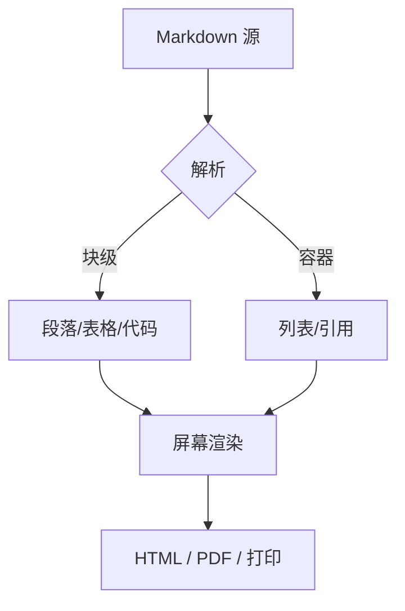

# 真实输出链路样张

本样张用于核验 Veil 的 HTML 导出、PDF 导出与系统「打印到 PDF」三条链路。以下内容同时包含中文、Latin、表格、代码、引用、列表、公式与 Mermaid 图，覆盖分页与断行的高风险组合。

## 一、中文断行与混排

秋水共长天一色，落霞与孤鹜齐飞。Veil 的目标不是做一个“能预览 Markdown”的阅读器，而是让写作者在屏幕上看到的就是纸面上的样子，并且把这份样子原样交到打印与导出链路。中文正文必须在任意汉字之间自然断行，同时避免行首出现逗号、句号、右括号等禁则字符；English words and inline code `veil_core::Session` must wrap at word boundaries, and a very long unbreakable token such as `https://example.com/a/very/long/path/that/does/not/contain/any/break/opportunity/at/all` should be handled without pushing the line outside the content box. 这一段刻意写长，用于观察打印 PDF 的页边距、行宽与分页位置是否与屏幕和内置 PDF 导出一致。

> 引用块用于验证左竖条、缩进与正文的层级关系。引用内再放一行中文与 English mixed text，观察竖条是否在所有行上对齐。

- 列表第一项：验证项目符号缩进。
- 列表第二项：包含行内公式 $E = mc^2$ 与行内代码 `cargo test --workspace`。
- 列表第三项：较长的中文条目，用来观察列表换行后的悬挂缩进是否保持。

## 二、表格

| 场景 | 中文说明 | 参数 | 结论 |
|---|---|---|---|
| 快速打开 | 5000 个 Markdown 文件时同步列目录 + 候选构建 | 约 13 ms | 不引入加载态 |
| PDF 代码字号 | 正文 11 pt × 0.875 | 9.625 pt | 与字阶同源 |
| PDF 表格字号 | 正文 11 pt × 0.8 | 8.8 pt | 与字阶同源 |
| 容器内 Mermaid | 列表/引用中的围栏暂不提升为图 | 已知限制 | 登记为 G7 |

## 三、代码块

```rust
fn main() {
    let theme = veil_ui::Theme::dark();
    println!("dark bg = {:?}", theme.bg);
    // 中文注释：代码块底色、行高与等宽字体在 PDF 中应保持可读。
    for i in 0..3 {
        println!("line {i}");
    }
}
```

## 四、公式

行间公式：

$$
\int_{0}^{1} x^2 \, dx = \frac{1}{3}
$$

## 五、Mermaid



## 六、分页压力段

为了观察分页，这里重复若干段等长中文。第一段：Veil 把同一份版面模型交给屏幕、内置 PDF 与系统打印，因此三者的页边距、行距与分页点应当一致；若出现差异，必须能在样张上定位到具体元素。第二段：导出 HTML 使用派生主题色，深色模式不得出现亮黄色 mark 块，标题层级必须与编辑器一致，代码块需要有可读的底色与前景对比。第三段：系统打印经过 GDI 与打印机驱动，字体替换与断行由打印上下文决定，这正是本轮要核验的部分。

为了观察分页，这里重复若干段等长中文。第一段：Veil 把同一份版面模型交给屏幕、内置 PDF 与系统打印，因此三者的页边距、行距与分页点应当一致；若出现差异，必须能在样张上定位到具体元素。第二段：导出 HTML 使用派生主题色，深色模式不得出现亮黄色 mark 块，标题层级必须与编辑器一致，代码块需要有可读的底色与前景对比。第三段：系统打印经过 GDI 与打印机驱动，字体替换与断行由打印上下文决定，这正是本轮要核验的部分。

为了观察分页，这里重复若干段等长中文。第一段：Veil 把同一份版面模型交给屏幕、内置 PDF 与系统打印，因此三者的页边距、行距与分页点应当一致；若出现差异，必须能在样张上定位到具体元素。第二段：导出 HTML 使用派生主题色，深色模式不得出现亮黄色 mark 块，标题层级必须与编辑器一致，代码块需要有可读的底色与前景对比。第三段：系统打印经过 GDI 与打印机驱动，字体替换与断行由打印上下文决定，这正是本轮要核验的部分。

## 七、结尾

以上为 W10 样张全部内容。
