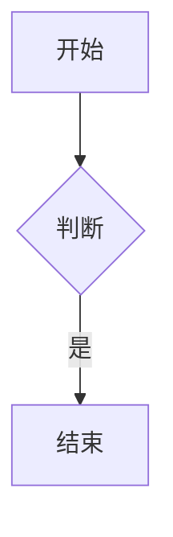
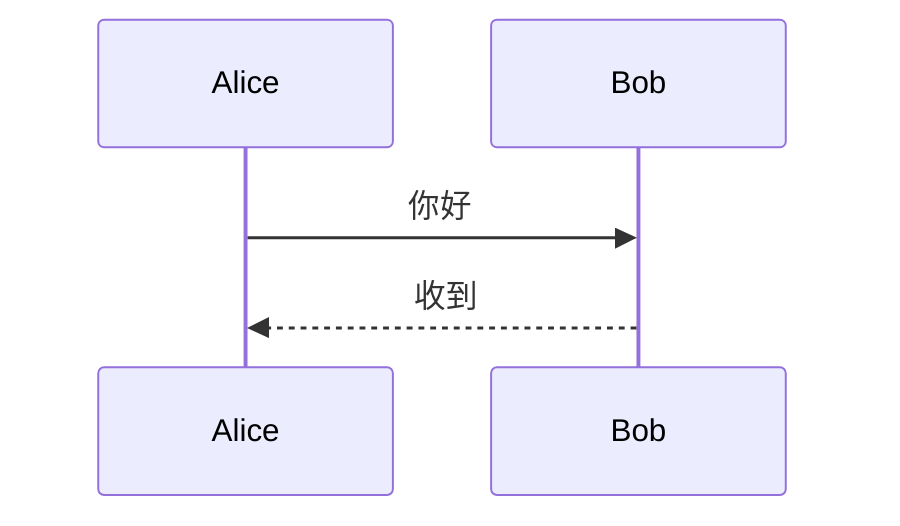
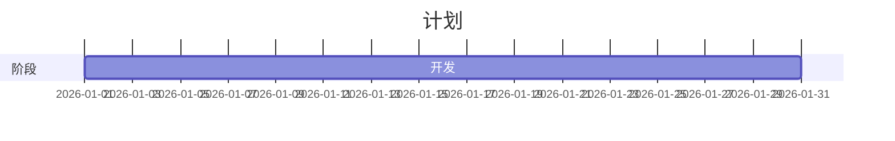
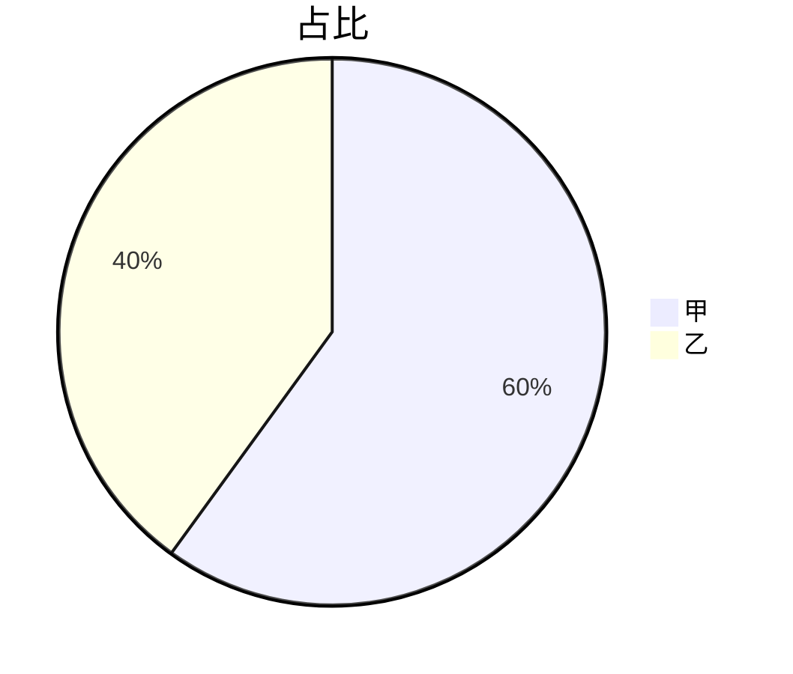
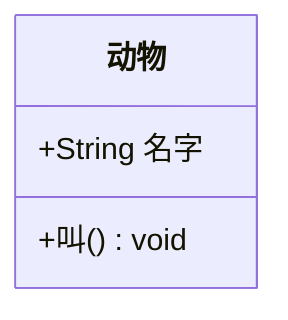
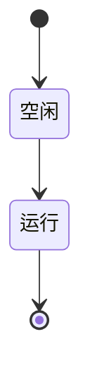
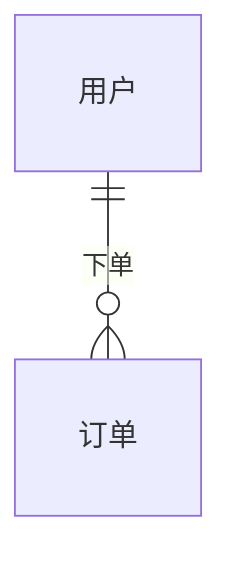

# Veil 语法矩阵（测试专用）

> 机读测试文档：每条用例只给出 Markdown 源、语义期望与可机检断言，不含截图、不引用仓库外大文件。
> 目标：同一份源在编辑器（WYSIWYG / 焦点行 / 打字机）与导出（HTML / PDF / 打印）之间不得分叉。
> 已知分叉（全角括号图片、表格单元格图片、表格贴邻图片）的用例在期望中写明「编辑器与导出一致」的具体表现。

## 解析契约

### 用例结构

每个用例必须以如下标题行开始，且同组编号从 001 连续：`### CASE-<组>-<三位编号> <标题>`。

组名取值：`BLK` 块级、`INL` 行内、`LNK` 链接、`IMG` 图片、`TBL` 表格、`CODE` 代码、`EXT` 扩展、`CJK` 中文与全角、`EDGE` 边界、`SEC` 安全。

标题行之后必须依次出现：

- `- 源：` —— 该行之后**立即**是围栏代码块，中间不得有空行、注释或其他字段。
- `- 期望：` —— 一行语义期望（作品契约，不因当前实现而弱化）。
- `- 表面：` —— `ALL`，或逗号分隔的 `WYSIWYG,FOCUS,TYPEWRITER,HTML,PDF,PRINT` 子集；不适用写 `N/A（原因）`。
- `- 检查：`（可选）—— 一行 `key=value`，以 `;` 分隔；同名 key 可出现多次，harness 逐条断言；子串值内不得出现 `;`。
- `- 字节：`（可选）—— 见下节；建议放在 `- 表面：` 之后，不改变必填字段顺序。

### 围栏规则

- 围栏语言标记固定为 `md`；围栏长度至少 3 个反引号。
- 当源内容本身含三反引号围栏时，使用 4 个或更多反引号，闭合围栏长度必须与开启围栏完全相等。
- 围栏内文本逐字节视为源：保留尾随空格（硬换行依赖它）、Tab、全角字符等；BOM、CRLF、无结尾换行由 `- 字节：` 指令施加。
- 除 `- 检查：` 外，其余字段均不得为空。

### 字节级变换（可选字段 `- 字节：`）

由于「BOM / CRLF / 无结尾换行」无法在围栏内逐字表达，允许增加一行 `- 字节：`，取值可逗号组合：

- `bom`：harness 落盘时在文件最前写入 U+FEFF；
- `crlf`：所有换行写为 CRLF；
- `no-final-newline`：去掉文件末尾换行。

未写该字段时按 LF + 结尾换行处理。

### `- 检查：` 支持的 key

| key | 值 | 语义 |
|---|---|---|
| `blocks` | 整数 | 编辑器语义块数（`<details>` 内部兄弟块计入；空行与 `</details>` 行不计） |
| `kinds` | 逗号分隔的块类型名 | 与 `blocks` 一一对应、顺序一致 |
| `html_contains` | 子串 | 导出 HTML 全文必须包含（大小写敏感，按导出原文） |
| `html_not_contains` | 子串 | 导出 HTML 全文必须不包含（大小写敏感） |
| `pdf_pages` | 整数 | 导出 PDF 页数 |
| `image_in_cell` | `true` | 单元格内图片在 HTML 与 PDF 中仍是单元格内元素，不得提升为块级或放大 |
| `no_overlap` | `true` | 渲染页（HTML/PDF）任意两块包围盒不相交；用于贴邻用例 |

`kinds` 允许的块类型名：`Paragraph`、`AtxHeading`、`SetextHeading`、`FencedCode`、`IndentedCode`、`Math`、`Mermaid`、`Table`、`ListItem`、`BlockQuote`、`Admonition`、`Callout`、`ThematicBreak`、`LinkRefDef`、`FootnoteDef`、`HtmlBlock`、`Details`、`FrontMatter`。

### 表面缩写

- `WYSIWYG`：所见即所得视图；`FOCUS`：焦点行显示源码标记；`TYPEWRITER`：打字机滚动；
- `HTML`/`PDF`/`PRINT`：三种导出表面，均以同一份源为输入。

### 组与条数

| 组 | 章节 | 条数 |
|---|---|---:|
| BLK | 块级 | 35 |
| INL | 行内 | 20 |
| LNK | 链接 | 9 |
| IMG | 图片 | 11 |
| TBL | 表格 | 18 |
| CODE | 代码 | 10 |
| EXT | 扩展 | 18 |
| CJK | 中文与全角 | 15 |
| EDGE | 边界 | 15 |
| SEC | 安全 | 12 |
| 合计 | — | 163 |

---

## 1. 块级（BLK，35 条）

### CASE-BLK-001 一级标题
- 源：
```md
# 一级标题
```
- 期望：渲染为单个 h1，文本与源码一致。
- 表面：ALL
- 检查：blocks=1; kinds=AtxHeading; html_contains=<h1>一级标题</h1>

### CASE-BLK-002 二级标题
- 源：
```md
## 二级标题
```
- 期望：渲染为单个 h2。
- 表面：ALL
- 检查：blocks=1; kinds=AtxHeading; html_contains=<h2>二级标题</h2>

### CASE-BLK-003 三级标题
- 源：
```md
### 三级标题
```
- 期望：渲染为单个 h3。
- 表面：ALL
- 检查：blocks=1; kinds=AtxHeading; html_contains=<h3>三级标题</h3>

### CASE-BLK-004 四级标题
- 源：
```md
#### 四级标题
```
- 期望：渲染为单个 h4。
- 表面：ALL
- 检查：blocks=1; kinds=AtxHeading; html_contains=<h4>四级标题</h4>

### CASE-BLK-005 五级标题
- 源：
```md
##### 五级标题
```
- 期望：渲染为单个 h5。
- 表面：ALL
- 检查：blocks=1; kinds=AtxHeading; html_contains=<h5>五级标题</h5>

### CASE-BLK-006 六级标题
- 源：
```md
###### 六级标题
```
- 期望：渲染为单个 h6。
- 表面：ALL
- 检查：blocks=1; kinds=AtxHeading; html_contains=<h6>六级标题</h6>

### CASE-BLK-007 单段落
- 源：
```md
这是一个普通段落。
```
- 期望：渲染为单个 p。
- 表面：ALL
- 检查：blocks=1; kinds=Paragraph; html_contains=<p>这是一个普通段落。</p>

### CASE-BLK-008 两段由空行分隔
- 源：
```md
第一段。

第二段。
```
- 期望：两个独立段落，不合并。
- 表面：ALL
- 检查：blocks=2; kinds=Paragraph,Paragraph; html_contains=<p>第一段。</p>; html_contains=<p>第二段。</p>

### CASE-BLK-009 软换行
- 源：
```md
第一行
第二行
```
- 期望：同一段内软换行，导出不产生 br。
- 表面：ALL
- 检查：blocks=1; kinds=Paragraph; html_contains=第一行; html_not_contains=<br

### CASE-BLK-010 硬换行（行尾两空格）
- 源：
```md
第一行  
第二行
```
- 期望：两空格触发硬换行，编辑器与导出均换行。
- 表面：ALL
- 检查：blocks=1; kinds=Paragraph; html_contains=<br

### CASE-BLK-011 硬换行（行尾反斜杠）
- 源：
```md
第一行\
第二行
```
- 期望：反斜杠触发硬换行，且反斜杠本身不显示。
- 表面：ALL
- 检查：blocks=1; kinds=Paragraph; html_contains=<br; html_not_contains=\

### CASE-BLK-012 分隔线（三个连字符）
- 源：
```md
---
```
- 期望：渲染为水平分隔线，不是标题或列表。
- 表面：ALL
- 检查：blocks=1; kinds=ThematicBreak; html_contains=<hr

### CASE-BLK-013 分隔线（三个星号）
- 源：
```md
***
```
- 期望：渲染为水平分隔线。
- 表面：ALL
- 检查：blocks=1; kinds=ThematicBreak; html_contains=<hr

### CASE-BLK-014 分隔线（三个下划线）
- 源：
```md
___
```
- 期望：渲染为水平分隔线，不误判为强调或标题。
- 表面：ALL
- 检查：blocks=1; kinds=ThematicBreak; html_contains=<hr

### CASE-BLK-015 普通引用
- 源：
```md
> 引用内容
```
- 期望：渲染为 blockquote，引用标记不显示。
- 表面：ALL
- 检查：blocks=1; kinds=BlockQuote; html_contains=<blockquote>; html_contains=引用内容

### CASE-BLK-016 嵌套引用
- 源：
```md
> 外层
> > 内层
```
- 期望：两层 blockquote，内外文本都不丢失。
- 表面：ALL
- 检查：html_contains=<blockquote>; html_contains=外层; html_contains=内层

### CASE-BLK-017 GFM 提示块 NOTE
- 源：
```md
> [!NOTE]
> 提示内容
```
- 期望：编辑器渲染为提示块，导出保留标题与正文，不丢内容。
- 表面：ALL
- 检查：blocks=1; kinds=Admonition; html_contains=提示内容

### CASE-BLK-018 GFM 提示块 WARNING
- 源：
```md
> [!WARNING]
> 风险内容
```
- 期望：渲染为警告样式提示块，正文不得丢失。
- 表面：ALL
- 检查：blocks=1; kinds=Admonition; html_contains=风险内容

### CASE-BLK-019 自定义 Callout FIXME
- 源：
```md
> [!FIXME]
> 待修内容
```
- 期望：配置含 FIXME 时渲染自定义 Callout；未配置时回退普通引用块；两条路径都保留正文。
- 表面：ALL
- 检查：html_contains=待修内容

### CASE-BLK-020 无序列表（连字符）
- 源：
```md
- 甲
- 乙
- 丙
```
- 期望：三项无序列表，列表标记不显示。
- 表面：ALL
- 检查：blocks=3; kinds=ListItem,ListItem,ListItem; html_contains=<ul>; html_contains=<li>丙</li>

### CASE-BLK-021 无序列表（星号）
- 源：
```md
* 甲
* 乙
```
- 期望：两项无序列表，与连字符标记效果一致。
- 表面：ALL
- 检查：blocks=2; kinds=ListItem,ListItem; html_contains=<ul>

### CASE-BLK-022 有序列表
- 源：
```md
1. 第一
2. 第二
3. 第三
```
- 期望：三项有序列表，编号连续。
- 表面：ALL
- 检查：blocks=3; kinds=ListItem,ListItem,ListItem; html_contains=<ol>; html_contains=<li>第三</li>

### CASE-BLK-023 嵌套无序列表
- 源：
```md
- 外层一
  - 内层一
  - 内层二
- 外层二
```
- 期望：两层无序列表，缩进层级正确。
- 表面：ALL
- 检查：blocks=4; kinds=ListItem,ListItem,ListItem,ListItem; html_contains=<ul>; html_contains=内层二

### CASE-BLK-024 有序列表嵌套无序列表
- 源：
```md
1. 外层一
   - 内层一
   - 内层二
2. 外层二
```
- 期望：有序外壳、无序内层，编号与缩进都正确。
- 表面：ALL
- 检查：blocks=4; kinds=ListItem,ListItem,ListItem,ListItem; html_contains=<ol>; html_contains=<ul>

### CASE-BLK-025 任务列表
- 源：
```md
- [ ] 未完成
- [x] 已完成
```
- 期望：两个复选框，第二项勾选；源码标记不显示。
- 表面：ALL
- 检查：blocks=2; html_contains=type="checkbox"; html_contains=checked

### CASE-BLK-026 紧凑列表
- 源：
```md
- 甲
- 乙
- 丙
```
- 期望：紧凑列表，项间无段落间距。
- 表面：ALL
- 检查：blocks=3; html_contains=<li>甲</li>; html_contains=<li>乙</li>

### CASE-BLK-027 松散列表
- 源：
```md
- 甲

- 乙
```
- 期望：松散列表，项间有间距，项内容包在段落里。
- 表面：ALL
- 检查：blocks=2; html_contains=<li>; html_contains=<p>甲</p>

### CASE-BLK-028 details/summary
- 源：
```md
<details>
<summary>展开我</summary>

隐藏内容

</details>
```
- 期望：渲染为可折叠块，summary 为标题，正文默认收起。
- 表面：ALL
- 检查：blocks=2; kinds=Details,Paragraph; html_contains=<details>; html_contains=<summary>展开我</summary>

### CASE-BLK-029 details 默认展开
- 源：
```md
<details open>
<summary>展开我</summary>

隐藏内容

</details>
```
- 期望：open 属性保留，初始为展开状态。
- 表面：ALL
- 检查：blocks=2; kinds=Details,Paragraph; html_contains=<details open

### CASE-BLK-030 YAML front matter
- 源：
```md
---
title: 测试
tags:
  - qa
---

# 正文
```
- 期望：首块识别为 FrontMatter 并渲染为元数据卡片，元数据不得作为正文文字输出。
- 表面：ALL
- 检查：blocks=2; kinds=FrontMatter,AtxHeading; html_not_contains=title: 测试

### CASE-BLK-031 TOML front matter
- 源：
```md
+++
title = "测试"
+++

正文
```
- 期望：`+++` 围栏识别为 FrontMatter，正文正常渲染。
- 表面：ALL
- 检查：blocks=2; kinds=FrontMatter,Paragraph; html_not_contains=title = "测试"

### CASE-BLK-032 TOC 标记（单中括号）
- 源：
```md
[TOC]

# 第一章
```
- 期望：源码保留 `[TOC]`，WYSIWYG 显示生成目录；导出不出现字面 `[TOC]`，标题仍为 h1。
- 表面：ALL
- 检查：blocks=2; kinds=Paragraph,AtxHeading; html_not_contains=[TOC]; html_contains=<h1>第一章</h1>

### CASE-BLK-033 TOC 标记（双方括号）
- 源：
```md
[[TOC]]

# 第一章
```
- 期望：`[[TOC]]` 与 `[TOC]` 行为一致，源码不被改写。
- 表面：ALL
- 检查：blocks=2; kinds=Paragraph,AtxHeading; html_not_contains=[[TOC]]; html_contains=<h1>第一章</h1>

### CASE-BLK-034 Setext 标题
- 源：
```md
标题
===
```
- 期望：识别为一级标题，下划线行不显示。
- 表面：ALL
- 检查：blocks=1; kinds=SetextHeading; html_contains=<h1>标题</h1>

### CASE-BLK-035 引用内列表
- 源：
```md
> - 甲
> - 乙
```
- 期望：引用容器内渲染无序列表，引用标记与列表标记都不显示。
- 表面：ALL
- 检查：html_contains=<blockquote>; html_contains=<li>甲</li>; html_contains=<li>乙</li>

---

## 2. 行内（INL，20 条）

### CASE-INL-001 斜体
- 源：
```md
这是*斜体*文字。
```
- 期望：仅“斜体”为 em，星号不显示。
- 表面：ALL
- 检查：blocks=1; html_contains=<em>斜体</em>

### CASE-INL-002 加粗
- 源：
```md
这是**加粗**文字。
```
- 期望：仅“加粗”为 strong。
- 表面：ALL
- 检查：blocks=1; html_contains=<strong>加粗</strong>

### CASE-INL-003 加粗与斜体嵌套（三星号）
- 源：
```md
***两者***
```
- 期望：同时加粗与斜体，em 与 strong 都出现且只包裹一次。
- 表面：ALL
- 检查：html_contains=<strong>两者</strong>; html_contains=<em>

### CASE-INL-004 加粗内嵌斜体
- 源：
```md
**外 *内* 外**
```
- 期望：strong 内包含 em，标记不泄漏。
- 表面：ALL
- 检查：html_contains=<strong>; html_contains=<em>内</em>

### CASE-INL-005 删除线
- 源：
```md
这是~~删除~~文字。
```
- 期望：GFM 删除线渲染为 del，波浪号不显示。
- 表面：ALL
- 检查：html_contains=<del>删除</del>

### CASE-INL-006 高亮
- 源：
```md
这是==高亮==文字。
```
- 期望：高亮渲染为 mark，等号不显示。
- 表面：ALL
- 检查：html_contains=<mark>高亮</mark>

### CASE-INL-007 行内代码
- 源：
```md
运行 `veil --help` 查看。
```
- 期望：code 样式显示，反引号不显示。
- 表面：ALL
- 检查：html_contains=<code>veil --help</code>

### CASE-INL-008 反斜杠转义
- 源：
```md
\*不是强调\*
```
- 期望：显示字面星号，不产生 em。
- 表面：ALL
- 检查：html_contains=*不是强调*; html_not_contains=<em>

### CASE-INL-009 HTML 实体
- 源：
```md
A &amp; B &copy; 2026
```
- 期望：实体正确显示为 & 与 ©，不显示实体源码。
- 表面：ALL
- 检查：blocks=1; html_contains=2026

### CASE-INL-010 上标
- 源：
```md
E = mc<sup>2</sup>
```
- 期望：sup 保留，指数上标显示。
- 表面：ALL
- 检查：html_contains=<sup>2</sup>

### CASE-INL-011 下标
- 源：
```md
H<sub>2</sub>O
```
- 期望：sub 保留，2 为下标。
- 表面：ALL
- 检查：html_contains=<sub>2</sub>

### CASE-INL-012 键盘按键 kbd
- 源：
```md
按 <kbd>Ctrl</kbd>+<kbd>S</kbd> 保存。
```
- 期望：两个 kbd 都保留，加号为普通文本。
- 表面：ALL
- 检查：html_contains=<kbd>Ctrl</kbd>; html_contains=<kbd>S</kbd>

### CASE-INL-013 缩写 abbr
- 源：
```md
<abbr title="HyperText Markup Language">HTML</abbr>
```
- 期望：abbr 与 title 属性保留，悬停可见全称。
- 表面：ALL
- 检查：html_contains=title="HyperText Markup Language"; html_contains=<abbr

### CASE-INL-014 行内数学
- 源：
```md
质能方程 $E=mc^2$ 很著名。
```
- 期望：行内数学按公式渲染，两侧美元符不显示，周围文字保持同一段。
- 表面：ALL
- 检查：blocks=1; kinds=Paragraph; html_contains=质能方程

### CASE-INL-015 钱币金额不误判为公式
- 源：
```md
价格是 $5 and $6 元。
```
- 期望：按普通文本显示，不产生行内数学节点。
- 表面：ALL
- 检查：html_contains=$5 and $6

### CASE-INL-016 行内公式含反斜杠命令
- 源：
```md
分数 $\frac{1}{2}$ 写作。
```
- 期望：反斜杠命令属于公式内容，不被当作 Markdown 转义吞掉。
- 表面：ALL
- 检查：blocks=1; kinds=Paragraph; html_contains=分数

### CASE-INL-017 星号两侧有空格不构成强调
- 源：
```md
* 不强调 *
```
- 期望：显示字面星号，不产生 em。
- 表面：ALL
- 检查：html_contains=* 不强调 *; html_not_contains=<em>

### CASE-INL-018 行内代码内的强调标记
- 源：
```md
`**x**`
```
- 期望：code 内容原样显示 `**x**`，不解析为 strong。
- 表面：ALL
- 检查：html_contains=<code>**x**</code>; html_not_contains=<strong>

### CASE-INL-019 链接内嵌加粗
- 源：
```md
[**粗**](https://example.com)
```
- 期望：a 内包含 strong，链接与样式同时生效。
- 表面：ALL
- 检查：html_contains=href="https://example.com"; html_contains=<strong>粗</strong>

### CASE-INL-020 行内代码含反引号
- 源：
```md
``a`b``
```
- 期望：双反引号包裹的内容为单个 code `a`b`，外层反引号不显示。
- 表面：ALL
- 检查：html_contains=<code>a`b</code>

---

## 3. 链接与图片（LNK 9 条 + IMG 11 条，共 20 条）

### CASE-LNK-001 行内链接
- 源：
```md
[Veil](https://example.com)
```
- 期望：链接可点击，href 与源码一致，方括号不显示。
- 表面：ALL
- 检查：blocks=1; html_contains=<a href="https://example.com">Veil</a>

### CASE-LNK-002 行内链接带 title
- 源：
```md
[文档](https://example.com "标题")
```
- 期望：title 属性保留，悬停显示“标题”。
- 表面：ALL
- 检查：html_contains=href="https://example.com"; html_contains=title="标题"

### CASE-LNK-003 引用式链接
- 源：
```md
[引用链接][r]

[r]: https://example.com/x
```
- 期望：链接解析到定义处；定义行在编辑器按源码显示，导出不产生多余文字。
- 表面：ALL
- 检查：blocks=2; kinds=Paragraph,LinkRefDef; html_contains=href="https://example.com/x"; html_contains=>引用链接</a>

### CASE-LNK-004 尖括号自动链接
- 源：
```md
<https://example.com/a>
```
- 期望：渲染为链接，文字为 URL 本身，尖括号不显示。
- 表面：ALL
- 检查：html_contains=<a href="https://example.com/a"

### CASE-LNK-005 裸 URL 自动链接
- 源：
```md
访问 https://example.com/x 查看
```
- 期望：GFM 自动链接，URL 成为可点击链接且尾部中文不并入。
- 表面：ALL
- 检查：html_contains=href="https://example.com/x"; html_contains=查看

### CASE-LNK-006 裸邮箱自动链接
- 源：
```md
联系 qa@example.com
```
- 期望：邮箱成为 mailto 链接。
- 表面：ALL
- 检查：html_contains=mailto:qa@example.com

### CASE-LNK-007 页内锚点链接
- 源：
```md
[跳到安装](#install)

## 安装
```
- 期望：锚点指向标题 id，点击可跳转。
- 表面：ALL
- 检查：blocks=2; html_contains=href="#install"; html_contains=id="install"

### CASE-LNK-008 相对路径链接
- 源：
```md
[说明](docs/a.md)
```
- 期望：相对路径原样保留为 href，不校验目标文件是否存在。
- 表面：ALL
- 检查：html_contains=href="docs/a.md"

### CASE-LNK-009 链接文字含强调与行内代码
- 源：
```md
[**粗体** 与 `code`](https://example.com)
```
- 期望：链接内 strong 与 code 都生效，链接样式不吞掉内层样式。
- 表面：ALL
- 检查：html_contains=<strong>粗体</strong>; html_contains=<code>code</code>

### CASE-IMG-001 相对本地图片
- 源：
```md

```
- 期望：需真实 `a.png` 才能显示；存在时显示图片，缺失时显示 alt 占位且不崩溃。
- 表面：ALL
- 检查：blocks=1; kinds=Paragraph; html_contains=alt="截图"

### CASE-IMG-002 引用式图片
- 源：
```md
![标志][logo]

[logo]: a.png
```
- 期望：图片解析到定义；需真实 `a.png`；缺文件时保留 alt。
- 表面：ALL
- 检查：blocks=2; kinds=Paragraph,LinkRefDef; html_contains=alt="标志"

### CASE-IMG-003 绝对路径图片
- 源：
```md

```
- 期望：绝对本地路径不读取，导出降级为 alt，不写出本机路径。
- 表面：ALL
- 检查：html_contains=alt="图"; html_not_contains=src="/assets/a.png"

### CASE-IMG-004 远程图片
- 源：
```md

```
- 期望：编辑器离线时显示占位；导出不联网、不把远程 URL 写进成品。
- 表面：ALL
- 检查：html_contains=alt="图"; html_not_contains=https://example.com/a.png

### CASE-IMG-005 data URI 位图
- 源：
```md

```
- 期望：位图 data URI 视为安全，直接显示。
- 表面：ALL
- 检查：html_contains=data:image/png; html_contains=alt="点"

### CASE-IMG-006 data URI SVG
- 源：
```md

```
- 期望：SVG data URI 可携带脚本，编辑器与导出都拒绝渲染，降级 alt。
- 表面：ALL
- 检查：html_not_contains=image/svg+xml; html_contains=alt="svg"

### CASE-IMG-007 图片带 title
- 源：
```md

```
- 期望：title 保留；需真实 `a.png`；缺文件时 alt 仍在。
- 表面：ALL
- 检查：html_contains=alt="图"

### CASE-IMG-008 图片居中容器
- 源：
```md
<p align="center"></p>
```
- 期望：居中容器保留，图片不被拆成独立块，容器内文字不消失。
- 表面：ALL
- 检查：html_contains=align="center"; html_contains=)
```
- 期望：尖括号目标中的空格被正确解析；需真实 `my file.png` 才能显示。
- 表面：ALL
- 检查：html_contains=alt="截图"; html_not_contains=<my file.png>

---

## 4. 表格（TBL，18 条）

### CASE-TBL-001 左对齐表格
- 源：
```md
| 名称 | 数量 |
| :--- | :--- |
| 甲 | 1 |
```
- 期望：表头与表体正常，两列左对齐。
- 表面：ALL
- 检查：blocks=1; kinds=Table; html_contains=<table>; html_contains=<th>名称</th>

### CASE-TBL-002 居中对齐表格
- 源：
```md
| 名称 | 数量 |
| :---: | :---: |
| 甲 | 1 |
```
- 期望：两列居中，单元格内容与源码一致。
- 表面：ALL
- 检查：blocks=1; kinds=Table; html_contains=<table>; html_contains=<td>甲</td>

### CASE-TBL-003 右对齐表格
- 源：
```md
| 名称 | 数量 |
| ---: | ---: |
| 甲 | 1 |
```
- 期望：两列右对齐。
- 表面：ALL
- 检查：blocks=1; kinds=Table; html_contains=<table>; html_contains=<td>1</td>

### CASE-TBL-004 混合对齐表格
- 源：
```md
| 左 | 中 | 右 |
| :-- | :-: | --: |
| 1 | 2 | 3 |
```
- 期望：三列分别为左、中、右对齐，互不影响。
- 表面：ALL
- 检查：blocks=1; kinds=Table; html_contains=<td>1</td>; html_contains=<td>3</td>

### CASE-TBL-005 单元格转义竖线
- 源：
```md
| 表达式 | 说明 |
| --- | --- |
| `a \| b` | 竖线 |
```
- 期望：`\|` 为单元格内竖线，不拆列；表格保持两列。
- 表面：ALL
- 检查：html_contains=<code>a | b</code>; html_contains=<td>竖线</td>

### CASE-TBL-006 单元格行内格式
- 源：
```md
| 格式 | 说明 |
| --- | --- |
| **粗** *斜* ~~删~~ | 混合 |
```
- 期望：单元格内 strong/em/del 都生效，表格结构不变。
- 表面：ALL
- 检查：html_contains=<strong>粗</strong>; html_contains=<del>删</del>; html_contains=<td>混合</td>

### CASE-TBL-007 单元格内图片
- 源：
```md
| 图片 | 说明 |
| --- | --- |
|  | 单元格图片 |
```
- 期望：编辑器与导出一致：HTML 保持完整 table，图片留在 td 内、保持小图，不提升为块级、不撑破表格；需真实 `a.png` 才显示。
- 表面：ALL
- 检查：blocks=1; kinds=Table; html_contains=<table>; html_contains=<td>; html_contains=alt="小图"; image_in_cell=true; no_overlap=true

### CASE-TBL-008 单元格内行内代码
- 源：
```md
| 命令 | 说明 |
| --- | --- |
| `veil --help` | 帮助 |
```
- 期望：code 在单元格内正常显示，表格不破裂。
- 表面：ALL
- 检查：html_contains=<code>veil --help</code>; html_contains=<table>

### CASE-TBL-009 单列表格
- 源：
```md
| 项目 |
| --- |
| 甲 |
| 乙 |
```
- 期望：单列表格正常渲染，表头与两行表体都在。
- 表面：ALL
- 检查：blocks=1; kinds=Table; html_contains=<th>项目</th>; html_contains=<td>乙</td>

### CASE-TBL-010 空单元格
- 源：
```md
| A | B | C |
| --- | --- | --- |
| 1 |  | 3 |
```
- 期望：中间空单元格保留为空 td，不塌列。
- 表面：ALL
- 检查：blocks=1; kinds=Table; html_contains=<td></td>; html_contains=<td>3</td>

### CASE-TBL-011 无首尾竖线
- 源：
```md
A | B
--- | ---
1 | 2
```
- 期望：省略首尾竖线仍识别为两列表格。
- 表面：ALL
- 检查：blocks=1; kinds=Table; html_contains=<th>A</th>; html_contains=<td>2</td>

### CASE-TBL-012 图片紧邻表格（图片在前）
- 源：
```md


| A | B |
| --- | --- |
| 1 | 2 |
```
- 期望：图片与表格各自成块，图片不并入表格；渲染页两者不重叠。需真实 `a.png`。
- 表面：ALL
- 检查：blocks=2; kinds=Paragraph,Table; html_contains=; no_overlap=true

### CASE-TBL-013 图片紧跟表格（图片在后）
- 源：
```md
| A | B |
| --- | --- |
| 1 | 2 |


正文
```
- 期望：编辑器与导出一致：图片可见且位于表格下方独立块；渲染页无大段空白、无重复表格。需真实 `a.png`。
- 表面：ALL
- 检查：blocks=3; kinds=Table,Paragraph,Paragraph; html_contains=<table>; html_contains=alt="下图"; html_contains=正文; no_overlap=true; pdf_pages=1

### CASE-TBL-014 表格在引用内
- 源：
```md
> | A | B |
> | --- | --- |
> | 1 | 2 |
```
- 期望：引用容器内渲染完整表格，引用标记不进入单元格。
- 表面：ALL
- 检查：blocks=1; kinds=BlockQuote; html_contains=<blockquote>; html_contains=<table>

### CASE-TBL-015 表格在提示块内
- 源：
```md
> [!NOTE]
> | A | B |
> | --- | --- |
> | 1 | 2 |
```
- 期望：提示块内渲染完整表格，提示正文不丢。
- 表面：ALL
- 检查：blocks=1; kinds=Admonition; html_contains=<table>; html_contains=<td>1</td>

### CASE-TBL-016 表格后紧跟段落
- 源：
```md
| A | B |
| --- | --- |
| 1 | 2 |
紧邻段落
```
- 期望：表格与段落是两个块，段落不被吞进表格，也不并成表格行。
- 表面：ALL
- 检查：blocks=2; kinds=Table,Paragraph; html_contains=<table>; html_contains=<p>紧邻段落</p>

### CASE-TBL-017 空表体
- 源：
```md
| A | B |
| --- | --- |
```
- 期望：只有表头的表格正常渲染，不崩溃、不产生空表体错误。
- 表面：ALL
- 检查：blocks=1; kinds=Table; html_contains=<table>; html_contains=<thead>

### CASE-TBL-018 表格内链接
- 源：
```md
| 站点 | 链接 |
| --- | --- |
| 示例 | [打开](https://example.com) |
```
- 期望：单元格内链接可点击，表格结构与对齐不受影响。
- 表面：ALL
- 检查：blocks=1; kinds=Table; html_contains=href="https://example.com"; html_contains=<table>

---

## 5. 代码（CODE，10 条）

### CASE-CODE-001 无语言围栏
- 源：
````md
```
echo hi
```
````
- 期望：按代码块原样显示，不解释内容。
- 表面：ALL
- 检查：blocks=1; kinds=FencedCode; html_contains=echo hi

### CASE-CODE-002 语言标注
- 源：
````md
```rust
fn main() {}
```
````
- 期望：按 rust 高亮，语言标记本身不显示。
- 表面：ALL
- 检查：blocks=1; kinds=FencedCode; html_contains=class="language-rust"; html_contains=fn main

### CASE-CODE-003 空围栏
- 源：
````md
```
```
````
- 期望：空代码块正常显示为空白代码区，不崩溃。
- 表面：ALL
- 检查：blocks=1; kinds=FencedCode; html_contains=<pre>

### CASE-CODE-004 未闭合围栏
- 源：
````md
```
未闭合的第一行
未闭合的第二行
````
- 期望：从开围栏到文末都视为代码，不吞掉后续文档（本用例无后续），编辑器不崩溃。
- 表面：ALL
- 检查：blocks=1; kinds=FencedCode; html_contains=未闭合的第一行

### CASE-CODE-005 缩进代码块
- 源：
```md
    fn main() {}
```
- 期望：四空格缩进识别为代码块，不是段落。
- 表面：ALL
- 检查：blocks=1; kinds=IndentedCode; html_contains=<pre>; html_contains=fn main

### CASE-CODE-006 超长代码行
- 源：
````md
```
let s = "abcdefghijklmnopqrstuvwxyzabcdefghijklmnopqrstuvwxyzabcdefghijklmnopqrstuvwxyzabcdefghijklmnopqrstuvwxyzabcdefghijklmnopqrstuvwxyzabcdefghijklmnopqrstuvwxyzabcdefghijklmnopqrstuvwxyz";
```
````
- 期望：超长行不截断、不丢字符，编辑器与导出都可横向滚动或按设置换行。
- 表面：ALL
- 检查：blocks=1; kinds=FencedCode; html_contains=abcdefghijklmnopqrstuvwxyz

### CASE-CODE-007 代码内含反引号
- 源：
````md
```
const s = "`";
```
````
- 期望：单个反引号不结束围栏，内容原样显示。
- 表面：ALL
- 检查：blocks=1; kinds=FencedCode; html_contains=const s = "`";

### CASE-CODE-008 代码内含 HTML
- 源：
````md
```
<script>alert(1)</script>
```
````
- 期望：标签按文本显示并转义，不执行、不产生真实 script 元素。
- 表面：ALL
- 检查：blocks=1; html_contains=alert(1); html_not_contains=<script

### CASE-CODE-009 四反引号围栏内含三反引号
- 源：
`````md
````
```
inner
```
````
`````
- 期望：外层四反引号围栏包住内层三反引号，内容原样显示。
- 表面：ALL
- 检查：blocks=1; kinds=FencedCode; html_contains=inner; html_contains=<pre>

### CASE-CODE-010 info string 多词
- 源：
````md
```rust ignore
fn main() {}
```
````
- 期望：语言取首词 rust 高亮，其余 info 词不显示。
- 表面：ALL
- 检查：blocks=1; kinds=FencedCode; html_contains=class="language-rust"

---

## 6. 扩展（EXT，18 条）

### CASE-EXT-001 Mermaid 流程图
- 源：
````md

````
- 期望：渲染为流程图；引擎失败时回退源码，不崩溃、不空白。
- 表面：ALL
- 检查：blocks=1; kinds=Mermaid; html_contains=<svg

### CASE-EXT-002 Mermaid 时序图
- 源：
````md

````
- 期望：渲染为时序图，参与者与消息都在。
- 表面：ALL
- 检查：blocks=1; kinds=Mermaid; html_contains=<svg

### CASE-EXT-003 Mermaid 甘特图
- 源：
````md

````
- 期望：渲染为甘特图，中文标题与日期不丢失。
- 表面：ALL
- 检查：blocks=1; kinds=Mermaid; html_contains=<svg

### CASE-EXT-004 Mermaid 思维导图
- 源：
````md

````
- 期望：渲染为思维导图，根节点与两个分支都在。
- 表面：ALL
- 检查：blocks=1; kinds=Mermaid; html_contains=<svg

### CASE-EXT-005 Mermaid 饼图
- 源：
````md

````
- 期望：渲染为饼图，标题与两项占比正确。
- 表面：ALL
- 检查：blocks=1; kinds=Mermaid; html_contains=<svg

### CASE-EXT-006 Mermaid 类图
- 源：
````md

````
- 期望：渲染为类图，类名与方法可见。
- 表面：ALL
- 检查：blocks=1; kinds=Mermaid; html_contains=<svg

### CASE-EXT-007 Mermaid 状态图
- 源：
````md

````
- 期望：渲染为状态图，三个状态迁移都在。
- 表面：ALL
- 检查：blocks=1; kinds=Mermaid; html_contains=<svg

### CASE-EXT-008 Mermaid ER 图
- 源：
````md

````
- 期望：渲染为 ER 图，实体与关系都在。
- 表面：ALL
- 检查：blocks=1; kinds=Mermaid; html_contains=<svg

### CASE-EXT-009 空 Mermaid
- 源：
````md
```mermaid
```
````
- 期望：空图不崩溃，显示空图占位或空代码块，不出现大段空白。
- 表面：ALL
- 检查：blocks=1; kinds=Mermaid

### CASE-EXT-010 块级公式
- 源：
```md
$$
E = mc^2
$$
```
- 期望：渲染为独立公式块，美元符不显示，上下留正常行距。
- 表面：ALL
- 检查：blocks=1; kinds=Math

### CASE-EXT-011 多行公式含对齐环境
- 源：
```md
$$
\begin{aligned}
a &= 1 \\
b &= 2
\end{aligned}
$$
```
- 期望：多行公式整体渲染，反斜杠换行属于公式内容。
- 表面：ALL
- 检查：blocks=1; kinds=Math

### CASE-EXT-012 行内公式与文字混排
- 源：
```md
质能方程 $E=mc^2$ 与 $a+b$ 都常见。
```
- 期望：公式与文字在同一段内，公式不独占一行。
- 表面：ALL
- 检查：blocks=1; kinds=Paragraph; html_contains=质能方程; html_contains=都常见

### CASE-EXT-013 脚注定义与引用
- 源：
```md
正文引用[^1]

[^1]: 脚注内容
```
- 期望：正文出现脚注角标，文档末尾生成脚注区；定义行不重复显示为正文。
- 表面：ALL
- 检查：blocks=2; kinds=Paragraph,FootnoteDef; html_contains=脚注内容; html_contains=<sup

### CASE-EXT-014 多脚注按首次引用编号
- 源：
```md
甲[^b] 乙[^a]

[^a]: 第一
[^b]: 第二
```
- 期望：编号按首次引用顺序：b 为 1、a 为 2，而不是按定义顺序。
- 表面：ALL
- 检查：blocks=3; kinds=Paragraph,FootnoteDef,FootnoteDef; html_contains=第一

### CASE-EXT-015 多行脚注定义
- 源：
```md
见[^1]

[^1]: 第一行
    续行第二行
```
- 期望：续行归入同一条脚注，不拆成新段落。
- 表面：ALL
- 检查：blocks=2; kinds=Paragraph,FootnoteDef; html_contains=续行第二行

### CASE-EXT-016 嵌套提示块
- 源：
```md
> [!NOTE]
> 外层
> > [!TIP]
> > 内层
```
- 期望：提示块内再嵌提示块，内外正文都显示，不丢层级。
- 表面：ALL
- 检查：blocks=1; kinds=Admonition; html_contains=外层; html_contains=内层

### CASE-EXT-017 details 内表格
- 源：
```md
<details>
<summary>表格</summary>

| A | B |
| --- | --- |
| 1 | 2 |

</details>
```
- 期望：表格属于 details 内部块，折叠时一起隐藏，展开时结构完整。
- 表面：ALL
- 检查：blocks=2; kinds=Details,Table; html_contains=<details>; html_contains=<table>

### CASE-EXT-018 details 内代码块
- 源：
````md
<details>
<summary>代码</summary>

```rust
fn main() {}
```

</details>
````
- 期望：代码块属于 details 内部块，不被当作 details 外部内容。
- 表面：ALL
- 检查：blocks=2; kinds=Details,FencedCode; html_contains=<details>; html_contains=fn main

---

## 7. 中文与全角输入（CJK，15 条）

### CASE-CJK-001 全角括号图片（已知分叉）
- 源：
```md
![]（未命名 .assets/image-3.png）
```
- 期望：编辑器与导出一致（统一按图片处理）；不得一侧渲染图片、另一侧当普通文字，也不得因此影响相邻块；需真实 `.assets/image-3.png` 才显示图。
- 表面：ALL
- 检查：blocks=1; html_contains=重点</strong>; html_contains=，请记住

### CASE-CJK-012 中文链接文字
- 源：
```md
[中文链接文字](https://example.com)
```
- 期望：中文链接文字正常显示并可点击。
- 表面：ALL
- 检查：html_contains=href="https://example.com"; html_contains=>中文链接文字</a>

### CASE-CJK-013 中文标题含加粗
- 源：
```md
## 中文**加粗**标题
```
- 期望：标题内加粗生效，标题层级与文本都不丢。
- 表面：ALL
- 检查：blocks=1; kinds=AtxHeading; html_contains=<h2>; html_contains=<strong>加粗</strong>

### CASE-CJK-014 中文列表含全角括号
- 源：
```md
- 第一项（含括号）
- 第二项（含括号）
```
- 期望：列表项完整，全角括号不被误判为图片语法。
- 表面：ALL
- 检查：blocks=2; kinds=ListItem,ListItem; html_contains=<li>第一项（含括号）</li>

### CASE-CJK-015 全角括号内行内代码
- 源：
```md
请使用（`Ctrl+S`）保存。
```
- 期望：括号内的 code 正常渲染，括号保留为文字。
- 表面：ALL
- 检查：html_contains=<code>Ctrl+S</code>; html_contains=）保存。

---

## 8. 边界（EDGE，15 条）

### CASE-EDGE-001 空文档
- 源：
```md

```
- 期望：空文档（围栏内仅一个空行）：不崩溃，不产生任何块；导出为空骨架。
- 表面：N/A（空文档没有可渲染内容，四表面均只应呈现空态）
- 检查：blocks=0

### CASE-EDGE-002 仅空行
- 源：
```md


```
- 期望：仅空行不产生块，光标可正常落在首行。
- 表面：N/A（无可见内容，仅断言不崩溃、不产生块）
- 检查：blocks=0

### CASE-EDGE-003 仅空格
- 源：
```md
   
```
- 期望：仅空格的文档不产生块，空格不被当作代码块。
- 表面：N/A（无可见内容，仅断言不产生块）
- 检查：blocks=0

### CASE-EDGE-004 BOM 开头
- 源：
```md
# 标题
```
- 期望：BOM 不显示、不破坏首块，编辑器与导出一致识别为 h1。
- 表面：ALL
- 字节：bom
- 检查：blocks=1; kinds=AtxHeading; html_contains=<h1>标题</h1>

### CASE-EDGE-005 CRLF 换行
- 源：
```md
第一行
第二行

# 标题
```
- 期望：CRLF 与 LF 行为一致：两行同段、空行分段、标题识别正确。
- 表面：ALL
- 字节：crlf
- 检查：blocks=2; kinds=Paragraph,AtxHeading; html_contains=第二行; html_contains=<h1>标题</h1>

### CASE-EDGE-006 Tab 缩进代码
- 源：
```md
	function f() {}
```
- 期望：Tab 按 4 列制表位展开，识别为缩进代码块。
- 表面：ALL
- 检查：blocks=1; kinds=IndentedCode; html_contains=function f() {}

### CASE-EDGE-007 无结尾换行
- 源：
```md
# 无尾换行
```
- 期望：文件末尾无换行也完整识别标题，保存回写不擅自增加内容。
- 表面：ALL
- 字节：no-final-newline
- 检查：blocks=1; kinds=AtxHeading; html_contains=<h1>无尾换行</h1>

### CASE-EDGE-008 超长单行
- 源：
```md
这是一条用于检查超长单行的段落，重复内容用于制造宽度压力。这是一条用于检查超长单行的段落，重复内容用于制造宽度压力。这是一条用于检查超长单行的段落，重复内容用于制造宽度压力。这是一条用于检查超长单行的段落，重复内容用于制造宽度压力。这是一条用于检查超长单行的段落，重复内容用于制造宽度压力。这是一条用于检查超长单行的段落，重复内容用于制造宽度压力。
```
- 期望：超长段落不丢字、不崩溃，横向滚动或换行由设置决定。
- 表面：ALL
- 检查：blocks=1; kinds=Paragraph; html_contains=宽度压力

### CASE-EDGE-009 深嵌套列表
- 源：
```md
- L1
  - L2
    - L3
      - L4
        - L5
```
- 期望：五层缩进层级正确，最深项仍可见。
- 表面：ALL
- 检查：blocks=5; kinds=ListItem,ListItem,ListItem,ListItem,ListItem; html_contains=L5; html_contains=<ul>

### CASE-EDGE-010 深嵌套引用
- 源：
```md
> L1
> > L2
> > > L3
> > > > L4
```
- 期望：四层引用都渲染，内容不丢，不出现无限缩进。
- 表面：ALL
- 检查：blocks=1; kinds=BlockQuote; html_contains=L4; html_contains=<blockquote>

### CASE-EDGE-011 重复标题
- 源：
```md
# 同名
# 同名
```
- 期望：两个 h1 都显示；锚点 id 全局去重（第二个为 `同名-1`），不冲突。
- 表面：ALL
- 检查：blocks=2; kinds=AtxHeading,AtxHeading; html_contains=id="同名"; html_contains=id="同名-1"

### CASE-EDGE-012 超长表格行
- 源：
```md
| A1 | A2 | A3 | A4 | A5 | A6 | A7 | A8 |
| --- | --- | --- | --- | --- | --- | --- | --- |
| 1 | 2 | 3 | 4 | 5 | 6 | 7 | 8 |
```
- 期望：八列表格列宽压缩或横向滚动，所有单元格可见且不串列。
- 表面：ALL
- 检查：blocks=1; kinds=Table; html_contains=<table>; html_contains=<td>8</td>

### CASE-EDGE-013 图片指向 0 字节文件
- 源：
```md

```
- 期望：需真实存在的 0 字节 `empty.png`；无法解码时降级 alt，不崩溃、不写坏导出件。
- 表面：ALL
- 检查：html_contains=alt="零字节"; html_not_contains=src="empty.png"

### CASE-EDGE-014 相对路径上跳
- 源：
```md

```
- 期望：相对路径按文档目录解析；越界或缺失时降级 alt，不读取目录外文件。
- 表面：ALL
- 检查：html_contains=alt="上级图"; html_not_contains=../assets/a.png

### CASE-EDGE-015 Unicode emoji
- 源：
```md
你好 😀 👨‍👩‍👧‍👦 🇨🇳
```
- 期望：emoji 与 ZWJ 组合、区域旗帜完整显示，不被拆成乱码或替换符。
- 表面：ALL
- 检查：blocks=1; kinds=Paragraph; html_contains=😀; html_contains=🇨🇳

---

## 9. 安全（SEC，12 条）

### CASE-SEC-001 javascript 链接
- 源：
```md
[点我](javascript:alert(1))
```
- 期望：不输出 javascript href，链接文字保留，点击无脚本执行。
- 表面：ALL
- 检查：html_not_contains=javascript:; html_contains=>点我</a>

### CASE-SEC-002 file 链接
- 源：
```md
[打开文件](file:///C:/Windows/win.ini)
```
- 期望：file 协议被拒绝，不把本机路径写进成品。
- 表面：ALL
- 检查：html_not_contains=file:; html_contains=打开文件

### CASE-SEC-003 data:text/html 链接
- 源：
```md
[页面](data:text/html;base64,PHNjcmlwdD5hbGVydCgxKTwvc2NyaXB0Pg==)
```
- 期望：data:text/html 被拒绝，链接文字保留，不生成可执行页面。
- 表面：ALL
- 检查：html_not_contains=data:text/html; html_contains=页面

### CASE-SEC-004 data:image/svg+xml 图片
- 源：
```md

```
- 期望：SVG data URI 可携带脚本，编辑器与导出都拒绝，降级 alt。
- 表面：ALL
- 检查：html_not_contains=image/svg+xml; html_contains=alt="图"

### CASE-SEC-005 远程图片不外联
- 源：
```md

```
- 期望：导出不发起网络请求、不保留远程 src；编辑器离线显示占位。
- 表面：ALL
- 检查：html_not_contains=https://evil.example; html_contains=alt="远程"

### CASE-SEC-006 原始 HTML script
- 源：
```md
<script>alert(1)</script>
```
- 期望：script 整段剥除，不执行、不残留源码文字。
- 表面：ALL
- 检查：html_not_contains=<script; html_not_contains=alert(1)

### CASE-SEC-007 原始 HTML style
- 源：
```md
<style>body{display:none}</style>
```
- 期望：style 整段剥除，不能隐藏页面内容。
- 表面：ALL
- 检查：html_not_contains=<style; html_not_contains=display:none

### CASE-SEC-008 原始 HTML iframe
- 源：
```md
<iframe src="https://evil.example"></iframe>
```
- 期望：iframe 剥除，不加载外部页面。
- 表面：ALL
- 检查：html_not_contains=<iframe; html_not_contains=evil.example

### CASE-SEC-009 白名单 details/kbd/img 保留
- 源：
```md
<details>
<summary>摘要</summary>

按 <kbd>Ctrl</kbd>，图片 

</details>
```
- 期望：details、summary、kbd 语义保留；img 走图片安全策略（缺失时保留 alt）。
- 表面：ALL
- 检查：blocks=2; kinds=Details,Paragraph; html_contains=<details>; html_contains=<kbd>Ctrl</kbd>; html_contains=alt="图标"

### CASE-SEC-010 属性事件 onerror
- 源：
```md

```
- 期望：on* 事件属性被剥除，图片降级或保留但绝不执行脚本。
- 表面：ALL
- 检查：html_not_contains=onerror; html_not_contains=alert(1)

### CASE-SEC-011 危险自动链接
- 源：
```md
<javascript:alert(1)>
```
- 期望：不构成链接，按文字转义显示，不产生 href。
- 表面：ALL
- 检查：html_not_contains=href="javascript; html_not_contains=<a href="javascript

### CASE-SEC-012 协议大小写与编码绕过
- 源：
```md
[大小写](JaVaScRiPt:alert(1))
[编码](java%0ascript:alert(1))
[实体](javascript&#58;alert(1))
```
- 期望：三种绕过都不产生可执行链接，链接文字保留。
- 表面：ALL
- 检查：html_not_contains=JaVaScRiPt; html_not_contains=java%0ascript; html_not_contains=javascript&#58
