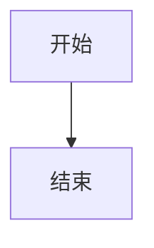

# 空 Mermaid 提示点击插入真机验收

## 1. 空 Mermaid 块（应有卡片头 + 提示行）

```mermaid
```

## 2. 纯注释 Mermaid 块（视为空，同样有提示行）

```mermaid
%% 只有注释，没有图形定义
```

## 3. 已有内容的 Mermaid 块（不应出现提示行）



## 4. 尾部锚点

本行用于验证插入模板后下方内容未被破坏。
